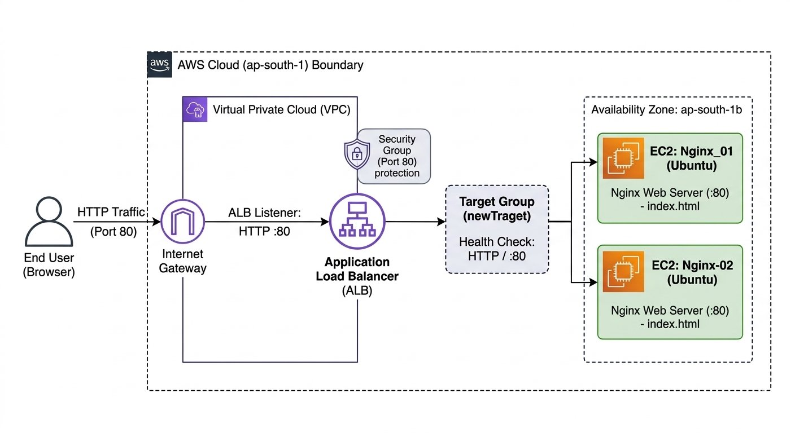

# aws-nginx-architecture-
# Highly Available Load-Balanced Web Architecture on AWS

A fault-tolerant web hosting architecture deployed on AWS using an **Application Load Balancer (ALB)**, **Target Groups**, and multiple **Ubuntu EC2 instances running Nginx**. This project demonstrates traffic distribution, automated health checks, network security configuration, and real-world Linux/AWS troubleshooting.

---

## Architecture Diagram



### Traffic Flow
1. **End User** sends an HTTP request (`Port 80`) to the Application Load Balancer's public DNS endpoint.
2. **Internet Gateway** routes incoming public traffic into the AWS **VPC (`ap-south-1`)**.
3. **Application Load Balancer (ALB)** evaluates the Listener Rule (`HTTP :80`) and forwards traffic to the registered **Target Group (`newTraget`)**.
4. **Target Group** distributes requests across healthy backend instances (**`Nginx_01`** and **`Nginx-02`**) while continuously running HTTP health checks against `/`.

---

## Tech Stack & AWS Services
* **Compute:** AWS EC2 (Ubuntu Linux)
* **Web Server:** Nginx
* **Load Balancing:** AWS Application Load Balancer (ALB), Target Groups, Listener Rules
* **Networking & Security:** AWS VPC, Subnets (`ap-south-1b`), Internet Gateway, Security Groups
* **Diagnostic Tools:** Linux CLI (`systemctl`, `ss`, `curl`, `ufw`), Nginx Access Logs

---

## Deployment & Configuration Steps

### 1. Provision & Configure EC2 Web Servers
* Launched two Ubuntu EC2 instances (**`Nginx_01`** and **`Nginx-02`**) inside `ap-south-1b`.
* Installed and enabled Nginx on both instances:
  ```bash
  sudo apt update && sudo apt install nginx -y
  sudo systemctl start nginx
  sudo systemctl enable nginx
  ```
* Deployed custom web content to `/var/www/html/index.html` on each server.

### 2. Configure Security Groups
* Created inbound firewall rules permitting **HTTP (`Port 80`)** from `0.0.0.0/0` (and SSH `Port 22` for administration) so the Load Balancer and clients can reach the web servers.

### 3. Configure Target Group & Application Load Balancer
* Created an HTTP Target Group (`newTraget`) listening on **Port 80** with health checks configured to `HTTP` on path `/` expecting status code `200`.
* Registered both **`Nginx_01`** and **`Nginx-02`** as targets.
* Provisioned an Internet-facing **Application Load Balancer** mapped across the VPC subnets and attached an `HTTP :80` listener forwarding 100% of traffic to `newTraget`.

---

## Key Troubleshooting & Engineering Learnings

During deployment, the Target Group initially reported targets as **`Unhealthy`**, preventing the Load Balancer from serving the updated `index.html`. I systematically isolated and resolved the issue across the OS and network layers:

1. **Verified Web Server & Local Response:**
   * Confirmed Nginx service status (`sudo systemctl status nginx`) and verified local HTTP `200 OK` responses using `curl -I http://localhost`.
2. **Audited Socket Bindings & Host Firewall:**
   * Verified Nginx was bound to all network interfaces (`0.0.0.0:80`) rather than only `localhost` using `sudo ss -tulpn | grep :80`.
   * Checked `sudo ufw status` to ensure the local Ubuntu firewall wasn't dropping health-check packets.
3. **Validated AWS Network Mapping & Security Groups:**
   * Confirmed both EC2 instances were registered to the Target Group, matched the ALB's enabled Availability Zone (`ap-south-1b`), and had `Port 80` open in their attached Security Groups.

---

## Proof of Work
*(Add your screenshots inside a `/screenshots` folder in your repo and update the links below)*

* **Healthy Target Group:** `./screenshots/healthy-targets.png`
* **Live Application via ALB DNS:** `./screenshots/live-website.png`

---

## Future Improvements
* **Multi-AZ High Availability:** Distribute instances across multiple Availability Zones (`ap-south-1a` and `ap-south-1b`) for data-center-level fault tolerance.
* **HTTPS Encryption:** Attach an SSL/TLS certificate via **AWS Certificate Manager (ACM)** and redirect `HTTP :80` to `HTTPS :443`.
* **Auto Scaling:** Integrate an **Auto Scaling Group (ASG)** to dynamically scale EC2 instances based on CPU or traffic load.
